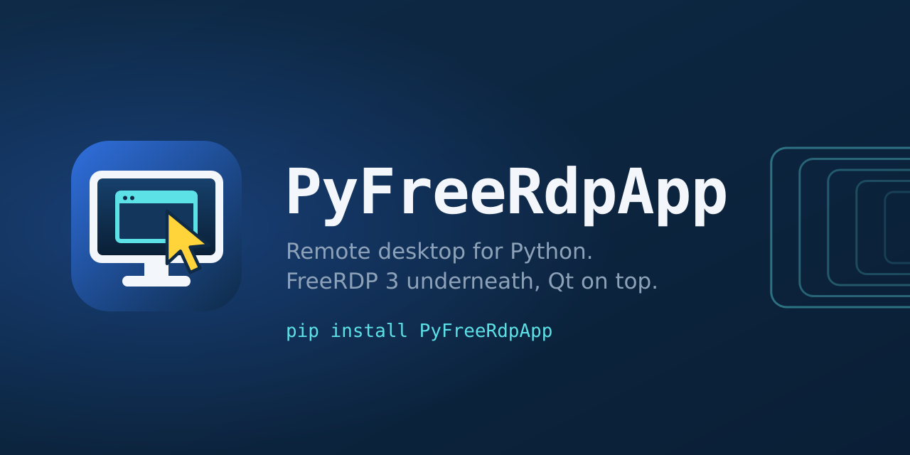
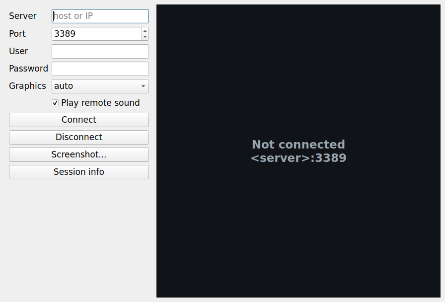

# PyFreeRdpApp

<p align="center">
  
</p>

A high-level RDP client for Python, built on
[pyfreerdpnative](https://github.com/Usama01TN/PyFreeRdpNative) (FreeRDP 3).
It wraps the low-level ctypes bindings in a small, task-oriented
`RDPApplication` class and an optional Qt widget.



## Install:

```bash
pip install pyfreerdpnative --find-links https://github.com/Usama01TN/PyFreeRdpNative/releases/expanded_assets/freerdp-libs-3.32.2
pip install .            # this package
pip install numpy pillow # getDisplay() as an array / image
pip install ManyQt       # optional, for the GUI
```

## Usage:

```python
from PyFreeRdpApp.keyboard import LEFT_CONTROL, KEY_A
from PyFreeRdpApp import RDPApplication, keyboard

app = RDPApplication()  # type: RDPApplication
app.setServer('10.0.0.5')
app.setUsername('alice')
app.setPassword('secret')
app.setDisplaySize(1280, 800)
app.start()
# Wait until ready, then drive it.
while not app.isReady:
    pass
app.typeText('Hello')
app.hotkey(LEFT_CONTROL, KEY_A)     # Ctrl+A
frame = app.getDisplay()            # numpy (h, w, bpp/8), BGR(A)
app.stop()
```

A window, if a Qt binding is installed:

```bash
python -m PyFreeRdpApp                       # asks for everything in a dialog
python -m PyFreeRdpApp 10.0.0.5 alice        # asks only for the password
python -m PyFreeRdpApp 10.0.0.5 alice secret --size 1920x1080 --share ~/Documents=Docs
python -m PyFreeRdpApp 10.0.0.5 alice secret --screenshot desk.png
```

Anything missing from the command line is asked for: in a dialog with Qt, on
the terminal without it (the password without echo). Without Qt, or with
`--screenshot`, it saves one frame and exits. `--help` lists every option.

### The window (`RDPWidget`):

Mouse, wheel and keyboard go to the remote machine (Tab included). The
clipboard works both ways: copy text on either side and paste on the other;
copy files in your file manager - or drag them onto the window - and paste
them remotely (when the server allows file transfer). Files copied remotely
are saved with **Shift + right-click → Download remote clipboard files...** or
`RDPWidget.downloadRemoteFiles(dir)`; a plain right-click goes to the remote
machine. The cursor follows the remote one (I-beam over text, resize arrows,
hidden in video players...). **Shift + right-click → Share a local folder...**
redirects a folder as a drive and reconnects.

## API:

`RDPApplication` behaviour on FreeRDP 3 (see `__init__.pyi` for the full signatures):

- **connection:** `setServer`, `setPort`, `setUsername`, `setPassword`,
  `setDomain`, `setDisplaySize`, `setBitsPerPixel` (16/24/32),
  `setAutoReconnect`, `setGraphics` (passed to FreeRDP as `/gfx:<option>`),
  `setFreerdpCliArgs` (parsed by FreeRDP's own command-line parser)
- **lifecycle:** `setPaused`, `start` (blocks until ready; raises `ConnectionError` on
  failure), `stop`; properties `isRunning`, `isReady`, `isReconnecting`, `isPaused`
- **keyboard:** `keyDown`, `keyUp`, `hotkey`, `typeText` - scancodes from the
  `keyboard` module. `typeText` sends space, newline, backspace and tab as real
  keys and everything else as Unicode (non-BMP characters as surrogate pairs)
- **mouse:** `mouseMove`, `{left,right,middle}Mouse{Down,Up}`, `mouseScroll`
- **screen:** `getDisplay(displayFormat=None)` returns the screen as
  `numpy` (array `(height, width, bpp/8)` of BGR(A) pixels, ready for OpenCV),
  `pillow` (RGB/RGBA image), `qimage`, `bytes` (packed BGR(A)) or `tuple`
  `(width, height, channels, bytes)`; `setDisplayFormat` changes the default
  (`numpy`)
- **clipboard listener:** `setClipboardListener(fn)` is told when the remote
  clipboard changes
- **clipboard:** `saveClipboard` / `loadClipboard` in `text` mode
  (`CF_UNICODETEXT`) and `file` mode (`FileGroupDescriptorW` + file contents
  streams, with `includeParent` and `filePattern`); `isFileClipboardEnabled`,
  `isFileTransferFinished`
- **folders:** `loadSharedDirectory` redirects a local folder as a drive
  ("Shared on <client>" in the remote Explorer); a file path shares its
  folder; several folders allowed; call before `start` (or restart);
  `getSharedDirectories` lists them. Only the folders you share are exposed -
  never the whole disk
- **pointer:** `setPointerListener(fn)` reports the remote cursor shape
  (`set` with BGRA pixels and hotspot, `hidden`, `default`, `position`)

Every input event is queued and sent from the RDP session thread, never from
the caller's thread - FreeRDP's transport is not safe for concurrent writes.
Methods raise `ConnectionError` when the session is not connected (`hotkey`
raises `RuntimeError`, as documented in the stub).

## The widget: `PyFreeRdpApp.rdpwidget`

`RDPWidget` is configurable entirely through Qt properties (getter, `@pyqtSlot`
setter and `pyqtProperty` for each): `server`, `port`, `username`, `password`,
`domain`, `displayWidth`, `displayHeight`, `bitsPerPixel`, `graphics`, `sound`,
`microphone`, `compressedAudio`, `autoReconnect`, `sharedDirectories`,
`freerdpCliArgs`, `fps`, `syncClipboard`, `autoConnect`, plus the read-only
`ready` and `running`. Every `RDPWidget` includes its `RDPApplication`: one is
created with the widget (`getApplication()` returns it), and the properties are
written straight through to it. Pass your own (`RDPWidget(app)`) to reuse a
session; the widget then mirrors its configuration.

```python
from PyFreeRdpApp.rdpwidget import RDPWidget

view = RDPWidget(server=u'10.0.0.5', username=u'alice', password=u'secret', autoConnect=True,
                 connected=lambda: print(u'Connected'), screenshotSaved=print)  # type: RDPWidget
view.show()
view.takeScreenshot(u'desk.png')         # or with no path: asks for one
print(view.getSessionInfo())             # status, connection and session information
```

Signals: `connected`, `disconnected`, `connectionFailed(str)`, `sessionRestarted(bool)`,
`remoteClipboardChanged(dict)`, `filesDownloaded(str)`, `clipboardError(str)`,
`screenshotSaved(str)`. Demo: `python PyFreeRdpApp/rdpwidget/main.py`.

### Clipboard, drag & drop, disconnections:

* **Drag & drop** files or folders onto the widget, or use **Send
  clipboard**: they go on the remote clipboard - paste them in the remote
  session (Ctrl+V). A drop is always a *copy* (the sources stay where they
  are). The status bar says what was sent; a message says why nothing could
  be (not connected, empty clipboard, or a server whose policy disables file
  transfer - text still works there). Signals: `clipboardSent(str)`,
  `clipboardError(str)`; method: `sendFiles(paths)`.
* **Disconnections**: when the session ends without you asking, or a
  connection fails, a dialog shows the cause as FreeRDP reports it - the
  server's reason (logged off, idle timeout, disconnected by an
  administrator, ...) or FreeRDP's error - with **Reconnect** and **Cancel**
  (details under *Show Details*). `RDPApplication.getDisconnectReason()`,
  `setDisconnectListener(fn)`, `RDPWidget.connectionLost(dict)` and
  `rdpwidget.DisconnectDialog` expose the same information.

### Icon and banner:

The icon ships in `PyFreeRdpApp/rdpwidget/images/` (PNG 16-512 px, SVG, ICO for Windows, ICNS for
macOS); `PyFreeRdpApp.rdpwidget.appIcon()` returns it as a `QIcon` with every size. The window,
its dialogs and the Qt Designer plugin use it. The banner is in `assets/` (`banner.png` 1280x640 -
GitHub's social preview size - `banner@2x.png` and `banner.svg`). Both are generated by
`python tools/make_artwork.py`.

### Run a program - through the protocol, no keyboard, no clipboard:

RDP has two ways to start a program, and PyFreeRdpApp uses both:

```bash
# RemoteApp session: the server starts the program and the session shows only its windows.
python -m PyFreeRdpApp SERVER USER PASSWORD --app notepad --app-args "C:\notes.txt" --workdir "%USERPROFILE%"
# a desktop session that starts a program instead of the desktop (alternate shell).
python -m PyFreeRdpApp SERVER USER PASSWORD --shell "cmd /k ipconfig"
```

```python
app.setRemoteApp(u'notepad', u'C:\\notes.txt')  # Before start(); the server starts it as the session comes up
app.start()
app.waitForRemoteApp()                       # its answer: RuntimeError with the reason if it refused
app.runCommand(u'cmd', u'/k ipconfig')       # more programs in the RemoteApp session, any time
app.setStartProgram(u'cmd /k ipconfig')      # or: the session's shell, sent with the logon
```

A RemoteApp program is started by a *Client Execute* order on the RemoteApp channel (MS-RDPERP);
the server answers, and a refusal comes back with its reason - not allowed (publish the program
as a RemoteApp, or allow unlisted programs: policy "Allow remote start of unlisted programs"), not
found, session locked. The alternate shell travels with the logon information; the server must
allow it (policy "Start a program on connection"; Windows client editions may ignore it), and the
session ends when the program exits. A desktop session offers no protocol way to start a program,
so in the window **Run program...** starts it at once in a RemoteApp session and, in a desktop
session, offers to reconnect as a RemoteApp session running it. The connect dialog has Program,
Arguments and *Start it as a RemoteApp / instead of the desktop*.

### Display and sound in sync:

Frames are shown the moment FreeRDP has painted them (`setFrameListener`), not on a polling timer:
from a finished frame to the window, the median is about 1.5 ms (it was 10 ms), 4.5 ms at the 90th
percentile. `RDPWidget.fps` (default 240) only spaces the repaints of a burst; only the changed area is
redrawn, scaled or not. FreeRDP reports the real audio playback latency to the server, which keeps
sound and picture together with it; a short playback buffer - `--audio-latency` / `setAudioLatency`,
default 50 ms (PulseAudio's own default is 100) - keeps that latency low. Raise it if the sound stutters
on a jittery network.

### Upload a file to the remote desktop, from the console:

```bash
python -m PyFreeRdpApp SERVER USER PASSWORD --upload C:\\usama.zip
```

The file (or folder) goes on the remote clipboard; the session then shows the desktop
(Win+D), clicks it and pastes (Ctrl+V), and the remote side downloads the file through the
clipboard channel. The command ends when every byte has arrived, with the exit code: 0
uploaded, 2 no such file, 4 the server forbids file copy through the clipboard (use
`--share` instead), 5 nothing was pasted, 6 incomplete. `--upload-wait SECONDS` (default 8)
gives the desktop time to appear - raise it for a first logon; `--upload-timeout` caps the
transfer (default 600). Win+D and Ctrl+V sit on the same keys in QWERTY, AZERTY and QWERTZ.

In the window: **Upload files...** on the toolbar (several files at once; progress in the status bar).
From Python: `app.uploadFiles(paths, progress=callback)` - blocking, so in a GUI run it on a worker
thread, as `RDPWidget.uploadFiles` does.

### Azure AD (Entra ID) sign-in and UDP transport - FreeRDP 3:

```python
app.setAzureAD(True)                      # the Microsoft login page opens; no password
app.setAzureAD(True, helper=u'qt', userAgent=u'...')
app.setTransport(u'udp')                  # default | udp | udp-preferred | tcp-only
```

```bash
python -m PyFreeRdpApp host.example --azure-ad [--aad-helper webview|qt|PATH] [--transport tcp-only]
```

The login page opens in a FreeRDP AAD helper shipped with pyfreerdpnative 0.3.0
(FreeRDP 3.33): `webview` uses the system's browser engine (WebKitGTK -
`libwebkit2gtk-4.1-0` on Linux -, WKWebView on macOS, Edge WebView2 on Windows),
`qt` uses Qt WebEngine from `pip install PySide6-WebEngine` (or PyQt6-WebEngine)
or the system's - on Linux/X11 Qt 6.5+ also needs `libxcb-cursor0`. `auto`
takes the webview helper, else the Qt one; a missing helper fails `start()`
with the reason. The dialog has a *Sign in with Azure AD* box, and the session
report shows the sign-in and transport. A server that refuses NTLM (3.33's new
`NTLM_BLOCKED` error) is answered with a hint to use Azure AD.

UDP multitransport needs a FreeRDP built with `WITH_RDPEUDP` (pyfreerdpnative
0.3.0 is); the server's offer then decides - the flags are those of FreeRDP's
own `/multitransport:<mode>`. With older pyfreerdpnative versions these
features are simply unavailable; everything else works as before.

### Releasing:

Pushing a tag `vX.Y.Z` tests, builds and publishes a release (PyPI or TestPyPI, and a GitHub
Release) - see [docs/RELEASING.md](docs/RELEASING.md) for the one-time setup and the steps.

### Qt Designer:

* **PyQt5 / PyQt6** (`pyqt5-tools designer`): set `PYQTDESIGNERPATH` to the
  `PyFreeRdpApp/rdpwidget` folder and make `PyFreeRdpApp` importable
  (`PYTHONPATH`). `RDPWidget` appears in the *PyFreeRdpApp* group; every
  connection option is editable in the property editor. `pyuic5` generates
  `from PyFreeRdpApp.rdpwidget import RDPWidget`.
* **PySide6** (`pyside6-designer`): set `PYSIDE_DESIGNER_PLUGINS` to the same
  folder; `register_rdpwidget.py` registers the widget.

Inside Designer the widget never connects (it shows its configuration); the
session starts at run time with `connectToServer()` or `autoConnect`.

### Screenshot and session report in the console:

`--screenshot` and `--info` run in the console only - no window, no dialog
(missing credentials are asked in the terminal) - and they combine:

```bash
python -m PyFreeRdpApp 10.0.0.5 alice secret --screenshot desk.png         # screenshot only
python -m PyFreeRdpApp 10.0.0.5 alice secret --info                        # status/connection/info only
python -m PyFreeRdpApp 10.0.0.5 alice secret --screenshot desk.png --info  # both
python -m PyFreeRdpApp 10.0.0.5 alice secret --info --json                 # stdout is pure JSON
```

Exit codes: 0 ok, 1 cancelled, 2 connection failed (the report still prints
with `--info`), 3 screenshot failed.

The report (console, JSON and the window's **Session info...**) also shows
what FreeRDP received from the server while connecting
(`RDPApplication.getServerInfo()`) - no extra connection is made:

* **Remote computer** - Windows version and build (e.g. *Windows Server 2022,
  10.0.20348*), NetBIOS/DNS computer and domain names, forest, server time:
  from the NTLM challenge of FreeRDP's own NLA exchange (servers using NLA).
* **Logon** - the logged-on user (domain\\user) and session ID, from the
  server's Save Session Info.
* **Connection security** - the negotiated RDP version (e.g. 10.12) and
  security protocol, from FreeRDP's settings.
* **Certificate** - the certificate FreeRDP verified (VerifyX509Certificate),
  decoded by FreeRDP's own certificate API: subject, issuer (self-signed or
  not), validity with the time left, signature algorithm, key type,
  alternative names, SHA-256 and SHA-1 fingerprints, PEM. No temporary files.

The window has **Screenshot...** and **Session info...** in its toolbar.

### Performance:

Frames are published by the RDP thread at the end of each paint: only the
rows the server changed are copied (one `memmove`), and viewers take just the
changed rectangle - typically a few KB instead of the whole screen. Input
wakes the session thread at once (sub-millisecond latency) instead of waiting
for the next poll. The Graphics Pipeline (`/gfx`, H.264 on the media
editions) is on by default; `setGraphics("off")` returns to legacy updates.

### Sound:

The remote sound plays locally by default (`setSound(False)` to mute,
`setSound(True, microphone=True)` to redirect the microphone as well), using
the platform's audio backend.

### Troubleshooting:

* **The program exits with 0xC0000005 / a segmentation fault.** On the next
  start (Windows) the app reads what Windows recorded about the crash - the
  faulting DLL, offset and exception code - logs it, and shows it once.
  Python-level stacks of every thread also go to stderr and to
  `pyfreerdpapp-crash.log` (with `--log DIR`).
* **Audio bandwidth.** `--pcm-audio` (`setSound(True, compressed=False)`)
  keeps the audio uncompressed - no audio decoder involved.
* **Clipboard files do not download.** The status bar says whether the server
  allows file transfer ("Clipboard: text + files"); Windows hosts can block it
  by policy while text still works. Every download step is logged
  (`PyFreeRdpApp.clipboard`), and the window reports the exact reason.
* **Black or frozen screen with the Graphics Pipeline.** Use `--gfx off`
  (`setGraphics("off")`) to fall back to legacy updates.

## Support:

If PyFreeRdpApp is useful to you, feel free to support its development:

<p>
  <a href="https://ba9chich.com/fr/IninouUsama"></a>
  <a href="https://ko-fi.com/usamatn"></a>
</p>

- **ba9chich:** [ba9chich.com/fr/IninouUsama](https://ba9chich.com/fr/IninouUsama)
- **Ko-fi:** [ko-fi.com/usamatn](https://ko-fi.com/usamatn)

Thank you :)

## License:

Apache-2.0. FreeRDP is Apache-2.0.
